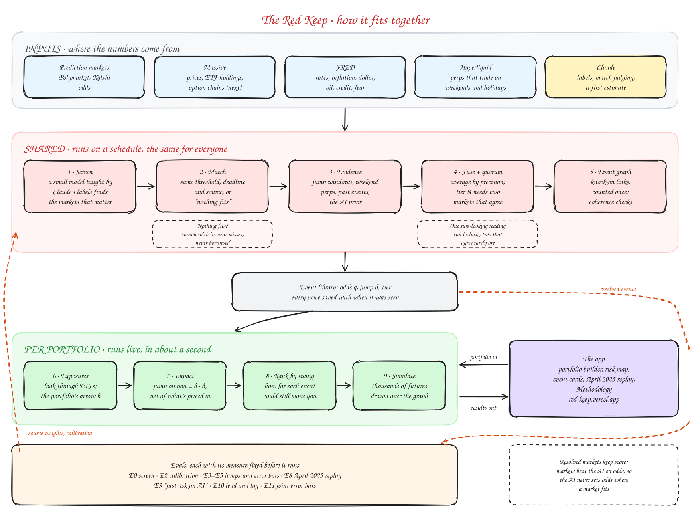
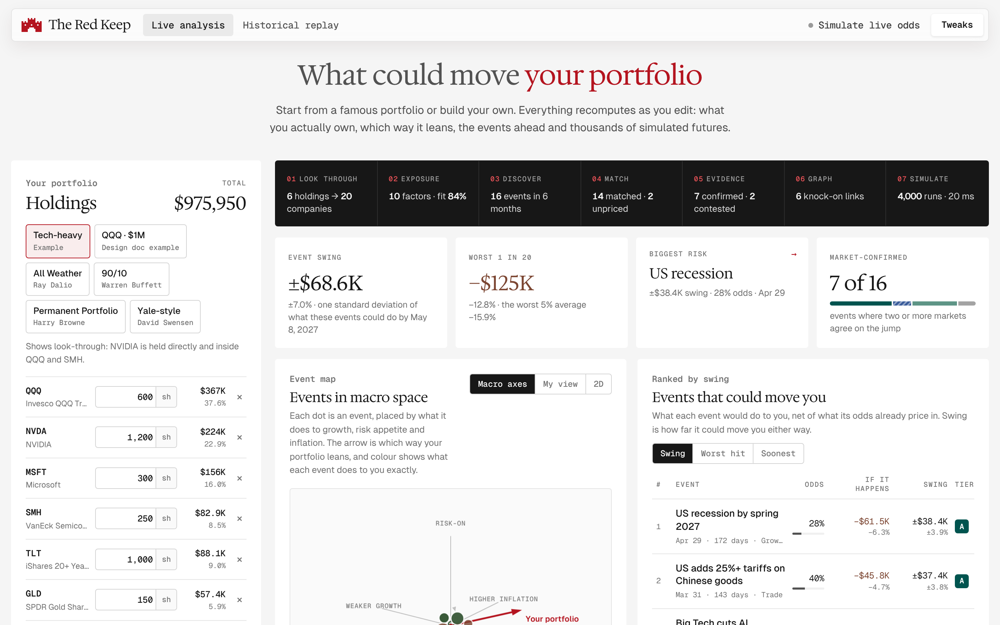

<!--
  Co-branding: add Castle's logo at docs/assets/castle-logo.svg, then uncomment the line below.
  

-->

# The Red Keep

### Hedging against dragons.

**Scenario Analysis Engine. Ashwin's Take-home for Castle**

*What could move your portfolio, net of what's already priced in.*

> Independent take-home project built for Castle Technologies. Not affiliated with or endorsed by Castle.

The first Red Keep had thick walls and no plan for dragons. This one starts with the dragons.

---

## The idea in one example

You hold $1M of QQQ. Prediction markets give "US tariffs on China of 25% or more" a 40% chance.

- If tariffs happen, QQQ's total jump is about **−8.5%**: −6% directly, plus the hit from recession odds rising 25 points.
- 40% of that jump is already in today's price.
- So the news itself would cost you **−5.1% (−$51K)** if tariffs happen, and you'd gain **+3.4% (+$34K)** if they don't.

Events are ranked by that two-way **swing**, not by how scary the headline sounds. All numbers here are illustrative.

## How it works

1. **See what you really own.** Look through ETFs to the stocks inside, then measure how the portfolio responds to ten macro factors (stocks, rates, inflation, the dollar, oil, credit, fear, China, chips, gold).
2. **Find the events that matter.** Screen every live Polymarket and Kalshi market with Laya, a small open-source model taught by Claude, and keep the ~100 that could swing this portfolio the most.
3. **Match events to markets.** Check each market's wording, threshold and deadline against the event, and say so when nothing fits.
4. **Let markets check each other.** Odds and impacts come from prediction markets, options, ETF prices in market hours and Hyperliquid's perps on weekends and holidays. A number is "confirmed" only when at least two independent markets agree, and disagreement is shown, not averaged away.
5. **Show it and prove it.** A portfolio builder, a 3D risk map, live analysis and a historical replay, backed by evals against a "just ask an AI" baseline.

## Try the prototype

A playable prototype on illustrative data. Start from a famous portfolio (Ray Dalio's All Weather, Warren Buffett's 90/10, Harry Browne's Permanent Portfolio, a Yale-style mix) or build your own, see the events that could move it, open any event to see its evidence and a hedge size, and replay the April 2025 tariff shock one day at a time.

- **Run it.** Clone the repo and open [`prototype/index.html`](prototype/index.html) in a browser. It loads React and fonts from public CDNs, so there is nothing to install.
- **Change it.** Edit the sources in [`prototype/src/`](prototype/src/), then rebuild with `python3 prototype/build.py`.
- **Check it.** `node prototype/check.js` confirms the prototype reproduces the worked example above and the identities in the design doc.

Every number in the prototype is illustrative. The real system computes them from markets, as the design doc describes.

## Docs

- [System design](docs/DESIGN.md): the math, every stage with its rejected alternatives, evals, edge cases, decisions and checked references.
- [Research: Hyperliquid's non-crypto perps](docs/research/hyperliquid-noncrypto-perps.md): which markets are usable for weekend jump windows, and how to measure them.
- [Diagrams](docs/diagrams/): Mermaid sources and rendered figures.

## Status

Design doc v0.2 and a playable prototype on illustrative data. Next: the data layer (M1 in the [build plan](docs/DESIGN.md#15-build-plan)).
