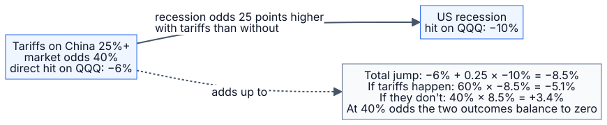
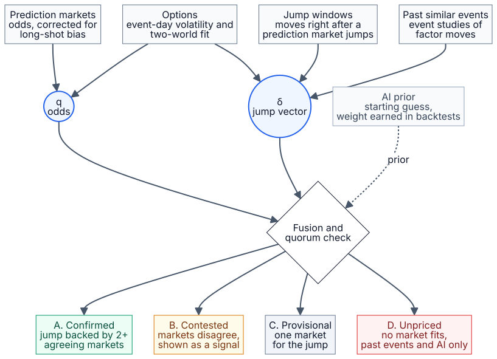
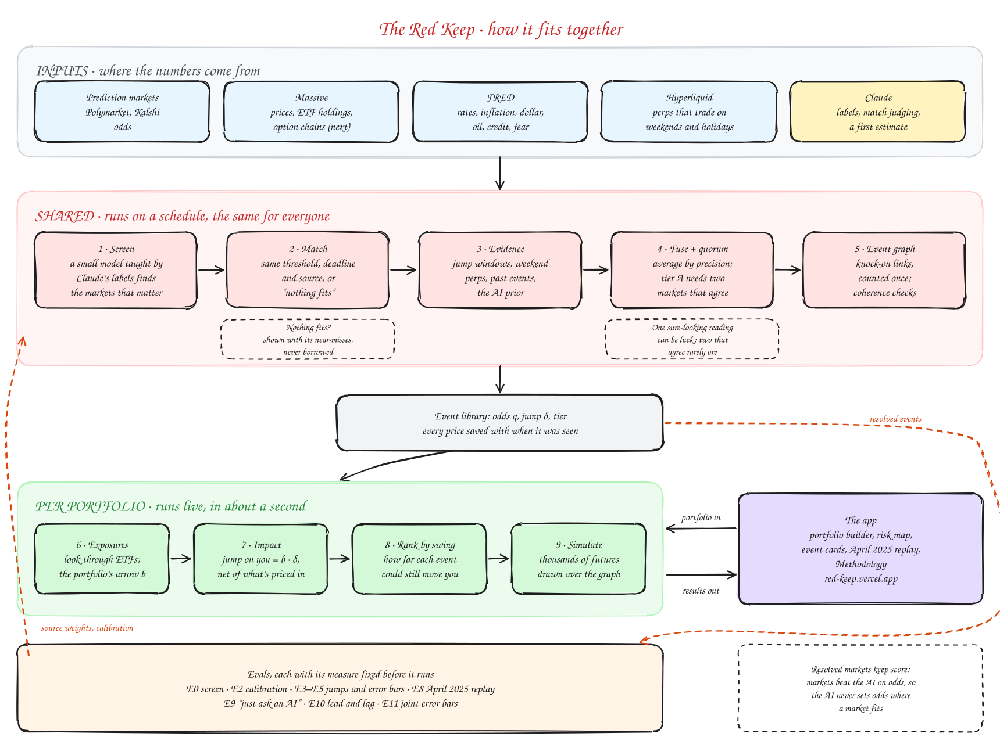
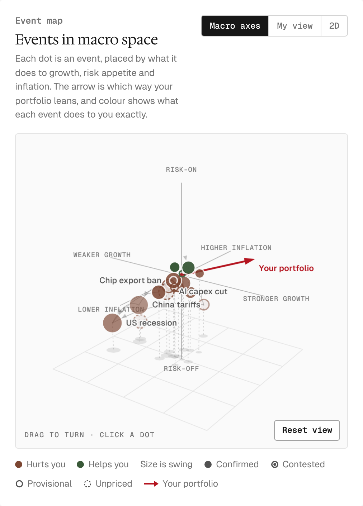

# The Red Keep: system design

**Scenario Analysis Engine. Ashwin's Take-home for Castle**

*What could move your portfolio, net of what's already priced in.*

Design draft v0.3 · November 2026 · Castle take-home, Option 1 (scenario analysis)

v0.3: the vertical slice (M3) is built in [`backend/`](../backend/README.md). [Section 15](#15-build-plan) says what runs today and what doesn't yet.

> Independent take-home project built for Castle Technologies. Not affiliated with or endorsed by Castle.

---

## Contents

1. [Summary](#1-summary)
2. [The problem and our goals](#2-the-problem-and-our-goals)
3. [The core idea in one example](#3-the-core-idea-in-one-example)
4. [The math](#4-the-math)
5. [Architecture](#5-architecture)
6. [Stage by stage](#6-stage-by-stage)
7. [Optional extension: hedging with event contracts](#7-optional-extension-hedging-with-event-contracts)
8. [Where the AI is used, and where it isn't](#8-where-the-ai-is-used-and-where-it-isnt)
9. [The app](#9-the-app)
10. [How we prove it works](#10-how-we-prove-it-works)
11. [Data sources](#11-data-sources)
12. [Edge cases](#12-edge-cases)
13. [Assumptions and limitations](#13-assumptions-and-limitations)
14. [Tech stack and repo layout](#14-tech-stack-and-repo-layout)
15. [Build plan](#15-build-plan)
16. [Decisions and open questions](#16-decisions-and-open-questions)
17. [References](#17-references)
18. [Glossary](#18-glossary)

---

## 1. Summary

Most risk tools list what *could* happen. The Red Keep tells you how much you would actually gain or lose **from today's prices** if each event happens, how confident it is, and why.

It works in five steps:

1. **See what you really own.** Look through ETFs to the stocks inside (QQQ becomes NVIDIA, Microsoft, Apple and so on), then measure how the portfolio responds to ten macro factors.
2. **Find the events that matter.** Screen every live Polymarket and Kalshi market with Laya, a small open-source model taught by Claude, and keep the ~100 that could swing this portfolio the most.
3. **Match events to markets.** Check each market's exact wording, threshold and deadline against the event, and say so when nothing fits.
4. **Measure odds and impact from several markets that check each other.** Prediction markets, options, and traded prices (ETFs in market hours, Hyperliquid's perps on weekends and holidays), plus past events and an AI prior. Each source is weighted by how accurate it has been in backtests.
5. **Show it and prove it.** An interactive app with a portfolio builder, a 3D risk map, live analysis and a historical replay, backed by evals against a "just ask an AI" baseline. A playable prototype on illustrative data is in [`prototype/`](../prototype/).

Five ideas set it apart:

- **Only the surprise counts.** Impact is measured net of what prices already reflect.
- **Money, not opinions.** Numbers come from markets. The AI reads, matches and fills gaps, but never overrides market evidence.
- **A market quorum.** A number is "confirmed" only when at least two independent markets agree. Disagreement is surfaced as a signal, not averaged away.
- **Events form a graph.** Knock-on effects, like tariffs raising recession odds, are counted once and only once.
- **Trust is earned.** Every source's weight, the AI's included, comes from its measured accuracy on events that have already resolved.

An optional extension sizes hedges with event contracts from the same numbers ([section 7](#7-optional-extension-hedging-with-event-contracts)).

---

## 2. The problem and our goals

From the brief: given a portfolio, (1) find the geopolitical and macro events most likely to move it, (2) put a probability on each, using prediction markets where relevant, and (3) estimate how much the portfolio would gain or lose if each happens. Three specific asks:

- Count what people hold through ETFs: someone who owns QQQ also owns NVIDIA.
- Show how events are matched to markets, and when we decide nothing fits.
- Account for the fact that today's prices already price in some of these events.

| Goal | What it means here |
|---|---|
| Correct about what's priced in | Report the move from today's price, not the full move |
| Grounded in markets | Market evidence first, AI second |
| Honest about uncertainty | Error bars, confidence tiers, an explicit "nothing fits" |
| Explainable | Every number traces back to its sources |
| Testable | Each stage has its own eval |
| Fast per portfolio | Heavy work is shared; per-portfolio math runs in about a second |
| A UI that teaches | The 3D map makes "direction matters, not just distance" intuitive |

**Non-goals for now:** portfolios that hold options or other non-linear instruments; executing trades; intraday trading signals; company-specific events (earnings, lawsuits) except for very large single holdings. Hedge sizing in section 7 is analysis, not advice.

---

## 3. The core idea in one example

You hold QQQ. Polymarket prices "US tariffs on China of 25% or more by March 31" at 40%. All numbers are illustrative.

| Step | Number | Where it comes from |
|---|---|---|
| Direct hit on QQQ if tariffs happen (full move) | −6.0% | Options, jump windows and the 2019 tariff escalation agree, so tier A |
| Recession odds with tariffs vs. without | +25 points | How the two prediction markets move together |
| Recession's hit on QQQ | −10.0% | The recession event's own evidence |
| **Total jump** | −6.0% + 0.25 × −10.0% = **−8.5%** | |
| Already priced in at 40% odds | 40% × −8.5% = −3.4% | |
| **If tariffs happen** | (1 − 0.40) × −8.5% = **−5.1%** | |
| **If they don't** | 0.40 × 8.5% = **+3.4%** | |
| Check | 0.40 × −5.1% + 0.60 × 3.4% = 0 | That is exactly what "priced in" means |



---

## 4. The math

### 4.1 Notation

| Symbol | Meaning |
|---|---|
| `b` | The portfolio's exposure, or "arrow": % gain or loss per typical move in each factor |
| `δ_e` | Event e's jump vector: how many typical moves each factor makes if e happens |
| `Δ_e = b · δ_e` | Event e's full jump on this portfolio, in % |
| `q_e` | The probability the market is pricing |
| `p̂_e` | Our calibrated probability, after correcting known biases |
| `V` | Portfolio value in dollars |

A **typical move** is one standard deviation of the factor's weekly change. Using it as the unit makes factors with different units (yields, prices, the VIX) comparable and addable.

### 4.2 What's priced in

Today's price is, to first order, the probability-weighted average of the two worlds:

`P_today ≈ q · P_yes + (1 − q) · P_no`

So with `Δ` the full jump between the worlds, as a share of today's value:

- if the event happens, the portfolio moves `(1 − q) · Δ`
- if it doesn't, it moves `−q · Δ`
- at market odds the expected move is zero. Our own expected P&L is `(p̂ − q) · Δ`, which is nonzero only where we think the market is wrong.

`q` is a market price, so it can carry a risk premium, and the stock market can be pricing a different probability than the prediction market. We measure that gap ([6.4](#64-evidence)) rather than assume it away.

### 4.3 Ranking by swing

`swing_e = q_e (1 − q_e) Δ_e²`

This is the variance the event adds to the portfolio's value. It is highest for coin-flip events with big jumps. In the UI we show it in dollars as `± V · |Δ_e| · √(q_e (1 − q_e))`, one standard deviation of the event's effect.

Why not the alternatives: expected value is always about zero at market odds (4.2); probability alone ignores size; size alone ignores whether the outcome is already all but known.

### 4.4 Knock-on effects through the event graph

Because `q_B = q_A · P(B|A) + (1 − q_A) · P(B|¬A)`, news that moves A's odds moves B's odds by

`w_AB = ∂q_B / ∂q_A = P(B|A) − P(B|¬A)`

So the total jump of event A on the portfolio is its direct jump plus the jumps it causes through its children in the graph:

`Δ_A_total = b · δ_A + Σ_B w_AB · Δ_B_total`

This is computed recursively; the graph has no cycles ([6.6](#66-event-graph)). The priced-in rule (4.2) then applies to `Δ_A_total`. The edge weight `w_AB` is exactly the slope you get by regressing changes in B's odds on changes in A's odds in news windows, which is how we estimate it. This is a first-order approximation that holds the children's other drivers fixed.

### 4.5 How each source measures the odds and the jump

Every source is a noisy reading of two hidden quantities per event: the odds `q` and the jump vector `δ`.

| Source | Measures | Model | Counts for less when |
|---|---|---|---|
| Prediction markets | `q` | `logit q_pm = logit q + bias(category, horizon) + noise` | The match is weak, the spread is wide, volume is thin |
| Options: event-day volatility | `\|Δ\|` | `J² ≈ q (1 − q) Δ²`, with `J²` from the volatility term structure | Options are illiquid or the event date is fuzzy |
| Options: two-world fit | `q`, `Δ` | Option prices as a mix of a "yes" and a "no" lognormal | The fit is unstable or shows no clear second mode |
| Jump windows | `δ` (signed) | `r_w = Σ_k δ_k · Δq_k,w + noise` over windows with sharp odds moves | Few windows, or other news in the same window |
| Past similar events | `δ` | Event study of factor moves around analog dates | The analogs are a poor fit |
| AI prior | `q`, `δ` | A starting guess with a measured error `τ_AI` | Always weak; `τ_AI` comes from backtests |

**Event-day volatility.** Let `σ₁, σ₂` be implied volatilities for expiries `T₁ < T₂`. If both expiries come after the event and ordinary volatility `σ_d` is steady, then `σ_i² T_i = σ_d² T_i + J²`, which gives `J² = T₁ T₂ (σ₁² − σ₂²) / (T₂ − T₁)`. If `T₁` is before the event and `T₂` after, `J² = T₂ (σ₂² − σ₁²)`. This term-structure idea is how Dubinsky et al. (2019) price earnings-announcement risk. For a yes/no event `J² ≈ q (1 − q) Δ²`, so `|Δ| ≈ J / √(q (1 − q))`. If the outcome itself varies in size (a tariff of 25% or 60%), this is an upper bound on `|Δ|`.

**Two-world fit.** Option prices around the event date are modeled as `C(K) = w · BS(K; F_yes, σ_yes) + (1 − w) · BS(K; F_no, σ_no)`, with `w · F_yes + (1 − w) · F_no = F`. The weight `w` is the options market's own (risk-neutral) probability and `ln(F_yes / F_no)` is its jump. Melick and Thomas (1997) used this mixture to read scenario probabilities for oil during the Gulf crisis.

**Jump windows.** We look at windows where one or more monitored prediction markets moved at least 5 points within 30 minutes, and regress factor-proxy returns in the window on all the odds changes in it. Including every market that moved separates direct effects from knock-on effects. We use changes in probability, not log-odds, because prices are linear in `q` (4.2). This borrows high-frequency identification from monetary economics (Gürkaynak, Sack and Swanson 2005; Nakamura and Steinsson 2018) and prediction-market event studies (Snowberg, Wolfers and Zitzewitz 2007). ETFs cover market hours. Hyperliquid's perps on stocks, oil, chips and (weakly) gold keep trading on weekends and holidays, and only then do they find their own price; while the reference market is open they copy it and add nothing new ([6.4](#64-evidence)). Rates, credit, breakevens and the VIX have no usable perp, so an off-hours window for those is measured at the next open with a wider error bar.

### 4.6 Fusion and the market quorum

**Version 1** (ship first). For each quantity, a precision-weighted average across sources: `x̂ = Σ w_s x_s / Σ w_s` with `w_s = 1 / σ_s²`. Each source's error `σ_s` is measured in backtests on resolved events ([section 10](#10-how-we-prove-it-works)), by event category, and inflated for weak matches and thin markets. A consistency check, `χ² = Σ (x_s − x̂)² / σ_s²`, flags disagreement larger than the error bars allow.

**Version 2.** A small Bayesian model (PyMC) that estimates `q` and `δ` jointly from all readings and pools information across related events, so all tariff events share a prior. It gives full posterior error bars.

**The quorum.** When a prediction market matches well, `q` is observed directly. The jump `δ` is always inferred, so `δ` is what needs the quorum.

| Tier | Rule | Shown as |
|---|---|---|
| **A · Confirmed** | `q` from a well-matched, liquid market, and `δ` backed by two or more independent market readings that agree (options, ETF windows, Hyperliquid weekend windows) | Normal |
| **B · Contested** | Two or more market readings of `q` or `δ` exist but disagree beyond their error bars | Flagged. The disagreement is the insight |
| **C · Provisional** | `q` observed, but `δ` has only one market reading, or the match is weak | Wider error bars |
| **D · Unpriced** | No prediction market fits; `q` and `δ` come from past events and the AI only | Labeled as a qualitative risk |

Events also get an "odds cross-checked" badge when Polymarket and Kalshi, or a prediction market and the options two-world fit, agree.



### 4.7 Scenario simulation

- Sample events in graph order, parents first. Each event's probability given its parents uses a logistic link whose intercept is solved so its overall probability matches its odds.
- In each simulated future the portfolio moves `Σ_e Δ_e_direct · (1[e happens] − q_e)`. Knock-on effects arrive through the sampled children. Optionally, ordinary day-to-day noise from the factor covariance is added over the horizon.
- Under market odds the average simulated move is zero by construction; under calibrated odds it is our view. We report the median, the 5th and 95th percentiles, expected shortfall, the events that drive the left tail, and the events that would help.
- Horizon: events that resolve within a chosen window, six months by default.

---

## 5. Architecture



The system has two layers:

- **Shared layer** (scheduled, the same for every user). The funnel, matcher, evidence collectors, fusion and graph produce an **event library**: for each of about 250 events, its odds, jump vector, tier, sources and explanations. The library is saved as dated snapshots, which is also what powers the historical replay.
- **Per-portfolio layer** (live). The exposure engine computes the portfolio's arrow; we rank library events by swing for this portfolio, compute impacts and run the simulator. Because this is mostly vector math over precomputed data, the target is about one second.

Evals run alongside. Resolved events feed the backtests, which set each source's weight and the long-shot correction.

**API sketch**

| Endpoint | Purpose |
|---|---|
| `POST /portfolio/analyze` | Holdings (ticker, shares), horizon and optional as-of date in; exposures, fit score, ranked events with impacts and a simulation summary out |
| `GET /events/{id}` | Sources, match explanation, tier and odds history for one event |
| `GET /events?as_of=` | An event-library snapshot |
| `POST /hedge/size` | Portfolio, chosen events and budget in; hedge legs out (section 7) |
| `WS /live` | Streaming odds and price updates |

---

## 6. Stage by stage

Each stage lists what it does, how, why, and the alternatives we rejected.

### 6.1 Exposure engine

**What.** Turns holdings into the portfolio's arrow `b`.

**How.**

1. **Look-through.** Expand ETFs into their holdings using issuer holdings data (Massive; fallback: the holdings files issuers publish). Recurse for funds of funds. Cash, bonds and crypto stay as their own lines.
2. **Sensitivities.** Regress each holding's daily returns on factor moves over about two years, weighting recent data more and shrinking noisy estimates toward the sector average. The portfolio's arrow is the weighted sum of its holdings' sensitivities. Estimating per holding, rather than regressing the portfolio's own history, works for brand-new portfolios and updates instantly when holdings change.
3. **Ten core factors**, each measured with a liquid proxy (table below).
4. **Extras.** From a library of about 30 more (sectors, regions, crypto, commodities), add the few that explain what the core leaves unexplained, but only if they improve fit on held-out data.
5. **Direct channel.** Holdings above about 5% of the portfolio also get their own stock-specific line, so an event aimed at one company, like a ban on NVIDIA selling certain chips to China, hits it directly.
6. **Stress exposures.** Also estimate sensitivities on high-volatility days only, and use them for large events, because markets move together more in sell-offs (Longin and Solnik 2001).
7. **Fit score.** The share of the portfolio's day-to-day movement the factors explain over the most recent six months, which the model did not see. Shown on every portfolio.

| # | Factor | Proxy | Typical events |
|---|---|---|---|
| 1 | US stocks | SPY | Almost everything |
| 2 | Interest rates | 10-year Treasury yield | Fed decisions, deficits, inflation scares |
| 3 | Inflation expectations | TIP vs. IEF, or the 10-year breakeven | Tariffs, oil shocks |
| 4 | US dollar | UUP or the dollar index | Tariffs, sanctions, Fed moves |
| 5 | Oil | Front-month crude or USO | Middle East, OPEC, Russia |
| 6 | Credit stress | HYG vs. IEF, or the high-yield spread | Recessions, banking scares |
| 7 | Fear | VIX | Wars, sudden shocks |
| 8 | China and trade | FXI | Tariffs, Taiwan, export controls |
| 9 | Chips and AI | SMH vs. SPY | Export controls, Taiwan, the AI spending cycle |
| 10 | Gold | GLD | Geopolitical fear, dollar debasement |

The three 3D display axes are published blends of these: **growth** (stocks, credit, oil, China), **inflation** (inflation expectations, oil, rates) and **risk appetite** (fear, credit and gold, inverted where needed).

**Why.** The brief requires look-through. Explaining returns with economic forces is a long-standing approach (Chen, Roll and Ross 1986), and estimating exposures from returns follows Sharpe's returns-based style analysis (Sharpe 1992). Regulators describe stress scenarios with the same families of variables: the Federal Reserve's 2025 supervisory scenarios specify 28 variables, including equity prices, Treasury yields, BBB corporate yields, the VIX, exchange rates and inflation (Federal Reserve Board 2025).

**Rejected.**

- Estimating event impacts stock by stock: noisy, doesn't scale, and doesn't explain *why*.
- Statistical factors (PCA): can explain a bit more movement, but they have no names, so neither the AI nor a user can reason about them.
- Sector labels only: miss real sensitivities, like tech's sensitivity to rates.

### 6.2 Event discovery funnel

**What.** From thousands of live markets to about 250 library events, and from those to the ~100 that matter for this portfolio.

**How.**

1. Pull all active Polymarket and Kalshi markets.
2. Cheap filters drop sports, entertainment and celebrity categories, markets below a volume and liquidity floor, and spreads too wide to be informative.
3. Fast screening with Laya, a small open-source decision model fine-tuned on Claude's labels ([section 8](#8-where-the-ai-is-used-and-where-it-isnt)), cached per market: is this macro or geopolitical; which factors would it move; rough direction and size per factor on a −2 to +2 scale. Markets Laya is unsure about go to Claude, which also writes a one-line reason for each market kept.
4. Group near-duplicates (the same question on two venues, or a ladder of thresholds or dates) into one event.
5. Keep events whose rough vector is material for at least one factor. These ~250 get the full evidence treatment on schedule.
6. **Portfolio-first.** The AI also proposes events from the portfolio's largest exposures and holdings, like "export controls on advanced chips", which may not have obvious markets. These go through matching, and if nothing fits they become tier D.
7. **Per portfolio,** rank by swing against the arrow and show the top ~100 (configurable).

**Why.** Costs stay low because the expensive estimation only runs where it can matter, and the screen itself takes milliseconds per market. Coverage is wide because we search market-first and portfolio-first. Ranking is principled because it uses swing.

**Rejected.** AI brainstorming only (ungrounded, and misses what markets are pricing); market-first only (misses unpriced risks); ranking by expected value (always about zero) or by probability alone (ignores size); a large model reading every market (accurate, but slow and costly when thousands of markets are re-screened on every refresh, so Claude teaches and checks instead).

### 6.3 Matching events to markets

**What.** For each event, decide which markets measure it, how well, and whether nothing fits.

**How.**

1. **Retrieve** candidates with hybrid search, keywords plus embeddings, over market titles and resolution rules.
2. **Judge** each candidate with a stronger AI model, a fixed rubric and structured output. Same entity? Same threshold (equal, stricter, looser)? Same deadline (earlier, later)? Same resolution source? The model labels the relationship (same question, implies, implied by, part of, overlaps, unrelated), gives a match score from 0 to 1, and quotes the rule text it relied on. "Part of" covers mutually exclusive outcomes whose union is the event, such as "cut 25 bps" and "cut 50 bps or more" for "the Fed cuts": their odds are summed.
3. **Ladders.** Markets that differ only by threshold or deadline are fitted together under monotonic constraints: a higher threshold can never be more likely, and a later deadline can never be less likely. We interpolate to the event's exact terms and never extrapolate past the ladder; outside it we report a bound.
4. **Bounds.** When only "implies" relationships exist, the probability is a range, for example `P(≥25%) ≤ P(≥20%) ≤ P(≥10%)`.
5. **"Nothing fits."** If the best match score is below a threshold, or the implied range is wider than a maximum, the event has no market and becomes tier D. We still show the closest near-miss and why it was rejected ("deadline differs by nine months"). Both thresholds are tuned on the labeled matching set (E1 in section 10).
6. Match quality flows into the evidence weights: a weaker match counts for less.

**Why.** The brief asks for exactly this. A rubric that checks thresholds and dates beats raw similarity, which cannot tell "25% or more by March" from "10% or more by June". Ranges are honest when the exact question isn't traded.

**Rejected.** Embeddings only (blind to thresholds and dates); always forcing the best match (silently wrong).

In Castle's terms, the gap between event and contract is **basis risk**: the chance that the contract and the event resolve differently. Section 7 uses it directly.

### 6.4 Evidence

**What.** For each library event, gather every available reading of `q` and `δ`.

**Prediction-market odds.**

- Use the midpoint, not the last trade. The error grows with the spread and shrinks with volume.
- Correct for the favorite-longshot bias with a calibration curve fitted on resolved markets, by category and time to expiry. The bias is well documented (Snowberg and Wolfers 2010), including on Kalshi, where low-priced contracts win far less often than their prices imply and prices become more accurate as markets approach closing (Bürgi, Deng and Whelan 2025). Otherwise, prediction markets are good aggregators of information (Wolfers and Zitzewitz 2004).
- Cross-venue check: when Polymarket and Kalshi both list an event, disagreement beyond the spreads is flagged.

**Options.**

- For scheduled events with liquid options on a factor proxy (SPY, QQQ, TLT, USO, GLD, FXI, SMH and others), extract the event-day variance from the term structure (Dubinsky et al. 2019) and convert it to `|Δ|` using `q`.
- Fit the two-world mixture around the event date (Melick and Thomas 1997) to get the options market's own odds and jump. Options do price political events (Kelly, Pástor and Veronesi 2016).
- When the options-implied odds differ from the prediction market's, that is a headline insight: "Polymarket says 45%, but your semis options are pricing about 20%."

**Jump windows.** Detect windows where any monitored market moved sharply, then regress factor-proxy returns in each window on all the odds changes in it (4.5). Market-hours windows on ETFs and off-hours windows on Hyperliquid are estimated separately, so they count as separate market readings for the quorum.

**Hyperliquid's weekend markets.** We checked which non-crypto perps are usable ([research note with 18 sources](research/hyperliquid-noncrypto-perps.md)). In short:

- **Who lists them.** Almost all come from one deployer, trade[XYZ] (coin names start with `xyz:`), which lists 118 markets: stock indexes, ETFs, currencies, commodities and single stocks.
- **When they add information.** Only while the reference market is closed. While it is open, the perp's oracle is that market's price, so the perp adds nothing new. On weekends and holidays it finds its own price, and that price carries real information: a Blockworks study of 614 market-weekends (March to July 2026, funded by the Hyperliquid Policy Center) found the last weekend price cut the error in predicting Monday's opening gap by 53%. A separate open-source analysis found the oil perp hedged 80 to 88% of the variance in Monday's gap, and gold only 17%.

| Factor | Market | Daily volume (Sep 2026 where dated) | Weekend windows |
|---|---|---|---|
| US stocks | `xyz:SP500`, `xyz:XYZ100` | About $185M a day each | Yes |
| Oil | `xyz:CL` (WTI), `xyz:BRENTOIL` | About $240M a day (WTI) | Yes, the strongest |
| Chips and AI | `xyz:NVDA`, `xyz:SMH` | Under $60M a day (NVDA); SMH is thin | NVDA only |
| Gold | `xyz:GOLD` | About $60M a day | Yes, with a weak signal |
| US dollar | `xyz:EUR`, `xyz:JPY` | About $10M a day across currencies | Marginal; the dollar-index perp was delisted |
| Interest rates | `xyz:TLT` | About $2M a day | Marginal |
| China and trade | `xyz:BABA` | About $8M a day | Weak |
| Credit, inflation expectations, fear | None | | No; measured at the next open |

- **How we measure.**
  - Use trades or the order-book midpoint, not the oracle. On weekends the oracle drifts toward the book with a 30-minute time constant, so 30 minutes after a jump it shows only about 63% of it.
  - Treat a move that hits the discovery bound as censored: a lower bound on the jump, not a reading. On the 28 February 2026 Iran-strike weekend the bound held oil's move to about 45% of Monday's gap.
  - Filter bad prints. One bad pre-market print sent `xyz:SKHYNIX` down 17.9% on 28 July 2026.
  - Give these windows wider error bars than ETF windows: weekend order books hold 31 to 50% of weekday depth.
- **Weeknights.** CME futures are deeper than the perps overnight, so weeknight windows should use futures if we can get the data ([section 16](#16-decisions-and-open-questions)). Hyperliquid's unique value is weekends and holidays.
- **Data access.** `POST api.hyperliquid.xyz/info` with `candleSnapshot`, using the dex prefix (`xyz:SP500`). Only the latest 5,000 candles are kept, about 3.5 days of one-minute bars, so we record from day one; Tardis (from December 2025) and 0xArchive (from October 2025) sell older history. The rate limit is 1,200 weight per minute per IP.
- **A bonus.** trade[XYZ] has run HIP-4 event contracts since 10 September 2026 on the same API, so some odds and prices share one clock.
- **Access.** We only read public data. Trading on trade.xyz is closed to US, UK and Canadian persons.

**Past similar events.** The AI proposes analog dates with reasons, for example the May 2019 tariff escalation. We run a standard event study of factor moves around them (MacKinlay 1997) and scale by how comparable each analog is.

**AI prior.** A structured estimate of `q` and `δ` with stated reasoning, used as the starting point. Its weight comes from its measured error.

### 6.5 Fusion and tiers

Implemented as in 4.6. Backtests produce per-category error tables for each source. Every number is stored together with the readings that produced it, so event cards can show them side by side.

### 6.6 Event graph

**What.** Links events so knock-on effects are counted once.

**How.**

1. **Hubs.** A small core of 15 to 30 macro hub events: recession, the Fed's path, inflation, tariffs, oil supply, major conflicts, elections. Other events attach to the hub they move with most, if any. Keeping the core small avoids overfitting.
2. **Candidate links.** The graphical lasso (Friedman, Hastie and Tibshirani 2008) on daily changes in log-odds finds which events move together *directly*, not just through a third event.
3. **Two-source rule for links.** The AI proposes which links make sense and in which direction. A link is kept only when the data and the AI both support it.
4. **Edge weights.** The slope of changes in the child's odds on changes in the parent's odds in jump windows (4.4).
5. **No cycles.** Events are ordered by resolution date and links only run from earlier to later. Loops like recession and Fed cuts are broken that way, and the break is noted.
6. **Coherence checks.** Ladders must be monotonic; joint events must satisfy `max(0, q_A + q_B − 1) ≤ P(A and B) ≤ min(q_A, q_B)`; a child's odds must lie between its two conditional values. Violations larger than the spreads are flagged as possible mispricings.

**Why.** It catches second-order risk and stops double counting events that move together. Bayesian networks have been proposed for exactly this kind of coherent stress testing (Rebonato and Denev 2014).

**Caveat.** Links are predictive, not causal. "If tariffs happen" means what markets would learn, not the effect of an intervention (see Pearl 2009 on the difference). The UI says so.

### 6.7 Impact and simulation

For each event: the full jump; the move if it happens and if it doesn't, in % and $; the swing; the tier; the sources. For the portfolio: the outcome distribution from the simulator, the events that drive the left tail, clusters of events pointing the same way, and the events that would help.

---

## 7. Optional extension: hedging with event contracts

This section is optional; the core engine stands without it. Once the engine knows each event's jump and odds, sizing a hedge with an event contract falls out of the same math, so it is a natural next step. The prototype already shows single-event sizing (7.1) on every event card, and its live feed of odds moves is the seed of tracking. The budgeted optimizer (7.3) and full tracking (7.5) are described here, not built.

### 7.1 Sizing a hedge

A YES contract bought at price `q` pays $1 if the event happens. If the event happens, the portfolio changes by `(1 − q) · Δ · V` (with `Δ < 0` for a risk), and `N` contracts gain `N (1 − q)`. Setting the two to cancel gives

**`N = |Δ| · V` contracts, costing `N · q`.**

If the event doesn't happen, the portfolio gains `q · |Δ| · V` and the contracts lose `N · q`, the same amount. One hedge size neutralizes the event in both worlds, and it falls straight out of the priced-in math.

*Example:* $1M in QQQ, tariffs at 40%, total jump −8.5%. Buy 85,000 contracts for $34,000. If tariffs happen, the portfolio loses $51,000 and the contracts net +$51,000. If they don't, the portfolio gains $34,000 and the contracts lose $34,000.

### 7.2 Basis risk from imperfect matches

When the contract isn't exactly the event, the hedge can miss. The matcher already measures this. With a ladder we know, for example, `P(tariffs land between 20% and 25%) = q_20 − q_25`: the chance the event happens but a "25% or more" contract pays nothing. Each hedge leg reports its basis risk, and contracts with smaller gaps are preferred.

### 7.3 A hedge portfolio under a budget

Given a premium budget, choose contracts across events to minimize the portfolio's tail loss (expected shortfall from the simulator). Minimizing expected shortfall over scenarios is a linear program (Rockafellar and Uryasev 2000), so this is fast and exact. Because the simulator includes the event graph, one contract can hedge linked risks; a recession contract partly hedges tariff risk.

### 7.4 The cost of protection

At market odds a hedge costs nothing on average, apart from fees and spreads. At calibrated odds, cheap long-shot contracts tend to be overpriced (6.4), so tail protection has an expected cost of about `N · (q − p̂)` plus fees. The app shows this next to each leg, so the user sees what the insurance costs as well as what it pays.

### 7.5 Track

A live view of the portfolio and its hedges as markets move, with alerts when an event's swing changes materially or a hedge drifts from its target size. Target sizes are recomputed from 7.1 as odds move.

---

## 8. Where the AI is used, and where it isn't

| Task | Model | Output | Guardrail |
|---|---|---|---|
| Funnel labels (teacher) | Stronger Claude model | Relevance and rough factor vector for a few thousand sample markets, with reasons | A hand-checked sample; versioned like code |
| Funnel screening | Laya, fine-tuned on those labels | Relevance and rough factor vector for every live market | Only a filter, never a final number; unsure cases go to Claude; measured in E0 |
| Portfolio-first brainstorm | Stronger Claude model | Candidate events | Must be matched, or labeled tier D |
| Match judging | Stronger | Relationship, match score, quoted rule text | Measured on the labeled set (E1) |
| Analog selection | Stronger | Past dates with reasons | The event study computes the numbers |
| Link proposals | Stronger | Direction and plausibility | Kept only if the data agrees |
| Priors | Stronger | Rough `q` and `δ` | Weight earned in backtests |
| Explanations | Stronger | Plain-language "why" on cards and disagreements | Grounded in the computed numbers |

Rules: the AI never produces a final number when market evidence exists. Calls use structured outputs against a schema and prompt caching, and opt into server-side fallback: if the model declines a request for policy reasons, the API retries it on the recommended fallback model and the response records which model answered. Every call is logged with its inputs and outputs, so any number can be audited, and cached, so a rerun returns the same answer. Prompts and rubrics are versioned and evaluated like code.

**Claude teaches, Laya scales.** Screening thousands of markets on every refresh is a narrow, repetitive job, which suits a *decision model*: a small model that returns a typed answer (a choice, a score or a yes/no) with a probability in a single pass, instead of writing text.

- **Laya** (Convai Innovations, September 2026) is open source under Apache 2.0: about 421M parameters, built on ModernBERT-large, with a median response time of about 33 ms. Out of the box it is close to guessing, so it has to be fine-tuned, which is what the loop below does.
- **Jev** (TypeSafe AI, September 2026) is the closed alternative: a paid API, in early access at about $0.042 per million input tokens. Laya's maker says Laya is about 7.8× faster than Jev, but that is the maker's own benchmark. Jev is our baseline: if fine-tuned Laya can't match Jev on E0 ([section 10](#10-how-we-prove-it-works)), we use Jev.
- **The loop.** Claude labels a few thousand markets with the funnel rubric; we fine-tune Laya on those labels; Laya screens every live market; markets it is unsure about, plus a random sample of the rest, go to Claude, and any disagreements become new training labels.

---

## 9. The app

### 9.1 Design language

The UI borrows Castle's component layer so it would sit comfortably next to their product, and adds The Red Keep's own accent and hero:

- **Type.** Serif display headings (Hedvig Letters Serif), including two-tone headings with an accent phrase; Geist for body text; Geist Mono for buttons, numbers and small uppercase, letter-spaced labels.
- **Surfaces.** A light gray canvas (`#F5F5F5`), flat white cards with 4px corners, ink text (`#171717`), a floating glass nav, and a dark band and footer.
- **Color.** Dragon red (`#B4141F`) as the accent. Losses use Castle's red-brown risk color (`#7C4632`) and gains forest green (`#395938`). Deep teal, blue and sage mark the confidence tiers.
- **Dark mode.** Maroon near-blacks instead of pure black, with a brighter red accent.
- **Hero.** The illustration at the top of the page: a red dragon breathes fire onto a castle on a sea cliff, in mauve and rose with a halftone texture.
- **Dragon story.** Between the hero and the app, a scroll story modelled on the manifesto on castle.tech, where short lines light up word by word over knights drawn in dark green characters. Here a lean dragon drawn entirely in crimson digits beats its wings and breathes fire upward while ten short lines in three chapters explain the engine: look-through, what's priced in, knock-on effects, the market quorum and ranking by swing. The fire grows as you read. The digits sit on a fixed grid, the wings and flame keep moving when scrolling stops, and a faint castle from the hero illustration sits behind the dragon. With reduced motion every word is lit, the dragon holds one still pose and the scene redraws only when you scroll. Tweaks can hide the hero image or the story.
- **Branding.** The Red Keep's own mark with "an independent take-home for Castle, not affiliated". Castle's logo is not used in the app.

### 9.2 Screens

1. **Portfolio builder**
   - Ticker search with autocomplete; enter shares or a dollar amount; live price and position value; weights computed automatically.
   - Edit, remove, import from CSV, and sample portfolios: four famous published allocations (below), a tech-heavy example and the $1M QQQ example from section 3.
   - A "what you really own" drawer: the look-through to underlying stocks, the arrow as bars across the ten factors, and the fit score.
2. **Risk dashboard** (home)
   - Headline numbers: total ± swing, the worst 1-in-20 outcome, the number of confirmed events.
   - A ranked event list: name, odds, if it happens and if it doesn't ($ and %), swing, tier and matched market.
   - The 3D risk map beside it (9.3).
   - An outcome chart: the distribution of simulated outcomes, with the tail shaded.
3. **Event card**
   - Every source side by side with error bars; why the market was matched, with quoted rule text; near-misses that were rejected; any cross-market disagreement; the event's links in the graph; its odds history.
4. **What-if explorer.** Click "tariffs happen" and watch odds and impacts ripple through linked events.
5. **Historical replay ("time machine")**
   - Pick a date or a preset episode, such as the April 2, 2025 tariff announcement and the pause a week later. Everything is rebuilt as of that date from snapshots and point-in-time data only.
   - Press play to step forward day by day and compare what the system predicted with what actually happened.
   - Works for the current portfolio or for a historical one built as of that date.
6. **Protect** (optional, [section 7](#7-optional-extension-hedging-with-event-contracts)). Pick events to hedge and set a budget; see the suggested legs, their cost, basis risk, and a before-and-after outcome chart ("raw event risk" vs. "hedged", Castle's own framing).
7. **Track** (optional). Live P&L of the portfolio and hedges, with alerts.

**Sample portfolios.** The demo centers on famous allocations whose weights are published, applied to $1M. No well-known trader publishes an exact personal ETF portfolio (Paul Tudor Jones and Meb Faber describe theirs only loosely), so we use famous model portfolios instead.

| Portfolio | Source | Holdings | Main sensitivity |
|---|---|---|---|
| All Weather | Ray Dalio's approach, as published by Robbins (2014) | 30% VTI, 40% TLT, 15% IEF, 7.5% GLD, 7.5% DBC | Hurt most by a rate spike (55% in Treasuries); helped by gold and inflation surges |
| 90/10 | Buffett (2013) | 90% VOO, 10% SHY | Hurt most by a stock crash |
| Permanent Portfolio | Browne (1999) | 25% each in VTI, TLT, BIL and GLD | Balanced; helped by gold and inflation surges |
| Yale-style | Swensen (2005) | 30% VTI, 15% VEA, 5% VWO, 20% VNQ, 15% TIP, 15% IEF | Hurt by a rate spike through REITs; helped by a weaker dollar |

### 9.3 The 3D risk map



- **Axes:** growth, inflation and risk appetite (blends of the ten factors, in typical moves).
- The origin is your portfolio today, your arrow is your exposure, and each event is a dot placed at its jump.
- **Dot size** is the swing, **color** says whether the event hurts or helps this portfolio, **fill** is the tier (solid A, ringed B, hollow C, dashed D), and **lines** are graph links.
- A dot's impact on you is how far it sits along or behind your arrow, not its distance from the origin. The same dot can matter a lot for one portfolio and not at all for another: an event that sits sideways to your arrow nets to about zero.
- **Clusters are themes.** Tariffs and an oil shock form a "stagflation" cluster; a cluster behind your arrow means concentrated risk. Dots in front of it are your upside.
- **Interactions:** orbit, hover for numbers, click for the event card or a what-if. Every 3D view has a 2D equivalent (impact against odds, with curves of equal swing) for readability and accessibility.
- **My view.** A second 3D mode built around your portfolio. Left to right is exactly what each event does to you; the other two axes are the directions your portfolio is blind to, found from the events themselves: the two directions in which the events' jumps vary most once your arrow's direction is taken out, with each event weighted by `q (1 − q)`.

### 9.4 Live updates

- The per-portfolio layer recomputes on every edit, targeting under a second.
- Prediction-market odds stream in, dots move live, and a "what changed since yesterday" feed lists the odds moves that matter to *this* portfolio.

---

## 10. How we prove it works

Ground rules: time-based splits only (fit on the past, test on the future), point-in-time data (no look-ahead), and metrics fixed before we run them.

| # | Eval | Question | Data | Metric | Baseline |
|---|---|---|---|---|---|
| E0 | Funnel screening | Does the cheap screen keep the markets that matter? | ~2,000 markets labeled by Claude, with a hand-checked sample | Recall of material markets at the kept size; precision; cost and latency per 1,000 markets | Claude on every market; Jev |
| E1 | Matching | Do we pick the right market, and say "nothing fits" when we should? | ~200 hand-labeled event-market pairs, including hard negatives | Precision and recall of match decisions; relationship-label accuracy; "nothing fits" precision | Embeddings only; AI without the rubric |
| E2 | Calibration | Do events priced at 70% happen about 70% of the time? | Thousands of resolved Polymarket and Kalshi markets | Brier score (Brier 1950), log loss, reliability curves; raw vs. corrected | Raw market prices |
| E3 | Jump accuracy | Do predicted jumps match what happened when events resolved? | Resolved events with clean resolution windows | Sign accuracy, mean absolute error, rank correlation | AI-only estimates |
| E4 | Error-bar coverage | Do our 80% intervals contain the truth about 80% of the time? | As E3 | Coverage | n/a |
| E5 | Quorum value | Are tier A numbers really more accurate than tier C? | As E3 | Error by tier | n/a |
| E6 | Source ablation | What does each source add? | As E3 | Change in error when each source is removed | Full system |
| E7 | Factor fit | How well do the factors describe each portfolio? | Sample portfolios | Out-of-sample R², residual check on news days | Market-only model |
| E8 | Historical replay | Would the system have helped on real days? | April 2025 tariffs and the pause; other episodes | Predicted vs. realized portfolio moves; ranking of the events that mattered | AI-only |
| E9 | "Just ask an AI" | Is the system better than a strong model with no tools? | Same portfolios and dates | E2, E3 and E8 metrics | Claude with no tools |

**Ground truth for jumps.** When a market resolves, its odds jump to 0 or 1, so the realized jump is the factor move in the resolution window divided by the odds change (`1 − q` or `−q`). The same data sets each source's weight (6.5): weights are fitted on an earlier period and evaluated on a later one, so the evals stay honest.

---

## 11. Data sources

| Source | Used for | Access | Notes |
|---|---|---|---|
| Massive | Stock and ETF prices, current and historical ETF holdings, option chains | API key from Castle (pending) | The key is expected to include options and historical holdings. Fallback: free daily prices and issuers' holdings files |
| Polymarket | Market list, prices, price history, resolutions | Public APIs | |
| Kalshi | Market list, prices, price history, resolutions | Public API | CFTC-regulated venue |
| Hyperliquid (trade[XYZ] markets) | Weekend and holiday prices for stocks, oil, chips and gold | Public API, read-only | Keeps only the latest 5,000 candles, so we record from day one; Tardis or 0xArchive for older history ([6.4](#64-evidence)) |
| FRED | Yields, breakevens, credit spreads, VIX (daily) | Public | Factor proxies and long history |
| Claude API | AI steps | Personal key | |
| Laya | Funnel screening | Open weights on Hugging Face (Apache 2.0) | Fine-tuned on Claude's labels; Jev is the fallback ([section 8](#8-where-the-ai-is-used-and-where-it-isnt)) |

---

## 12. Edge cases

| Case | Handling |
|---|---|
| No market fits | Tier D, clearly labeled; show the nearest near-miss and why it was rejected |
| Threshold or date mismatch | Ladder interpolation under monotonic constraints; a bound outside the ladder; wider errors |
| Illiquid or stale market | Use the midpoint; error grows with the spread; drop below a volume floor |
| Odds near 0% or 100% | Drop the event-day volatility equation, which can't pin down `Δ` there; the event matters little anyway |
| Unscheduled event | No event-day volatility to read; rely on jump windows and analogs, which often means tier C |
| Sign unclear | Event-day volatility gives size only; the sign comes from windows or analogs; if they disagree, tier B |
| Several stories at once | Windows include every market that moved; drop windows with unmonitored news |
| Multiple-outcome markets | Treat as one categorical variable whose probabilities sum to 1 |
| Correlated events | The graph and the simulator prevent double counting |
| Missing or stale ETF holdings | Fall back to returns-based exposures for that fund |
| Off-hours news | Weekends and holidays: Hyperliquid perps for stocks, oil, chips and gold. Weeknights: CME futures where we have them. Everything else: next-open gaps, with wider errors |
| A perp at its discovery bound | Censored: the move is a lower bound on the jump, not a reading |
| A bad print on a perp | Filter outliers against the order book and nearby trades; drop the window if in doubt |
| Market resolved or rules changed | Removed from the library; rule changes detected by hashing the resolution text |
| Events far in the future | Horizon filter, six months by default and user-adjustable |
| Holdings with options | Out of scope; flagged in the UI |

---

## 13. Assumptions and limitations

| Assumption | Why it's reasonable | How we test it | If it fails |
|---|---|---|---|
| Effects scale linearly (the dot product) | A first-order approximation for moderate moves | Predicted vs. realized by event size (E3) | Stress-period exposures for large events |
| The prediction-market price reflects what's priced in | It is the market's probability, and liquid markets are reasonably calibrated | E2 | Calibration correction; cross-venue and options checks |
| Every market prices the same probability | Not assumed: we measure the gap | Frequency of tier B; E8 | Surfaced as an insight |
| The factor set describes the portfolio | Macro factors capture the channels events travel through | E7 fit score | Automatic extras; the direct channel |
| Graph links are stable over the horizon | Links change slowly relative to six months | Rolling re-estimation | Shorter windows; wider errors |
| Links are predictive, not causal | That is what "if this happens, what do markets learn" needs | n/a | Stated in the UI |
| Past analogs resemble today | Used only as a prior | E6 ablation | Their weight shrinks automatically |
| Weekend perp prices anticipate Monday's open | Studies find they cut the error in predicting Monday's gap by about half: strongly for oil, weakly for gold | Compare weekend jumps with the next ETF open, by factor | Lower that factor's weight, or drop its weekend windows |

---

## 14. Tech stack and repo layout

- **Backend:** Python 3.12 and FastAPI; pandas, NumPy and SciPy; statsmodels for regressions; scikit-learn for the graphical lasso and isotonic regression; PyMC for fusion v2; DuckDB for market data and point-in-time snapshots; a scheduler for the shared jobs.
- **AI:** the Anthropic Python SDK, with a stronger Claude model for funnel labels, matching, analogs and explanations, and for the markets Laya is unsure about. Structured outputs and prompt caching. Laya runs with Hugging Face Transformers on CPU.
- **Frontend:** Next.js with TypeScript and Tailwind; react-three-fiber for the 3D map; Recharts or visx for 2D charts; websockets for live updates.
- **Prototype:** a single-page React app with no build step (React and htm from a CDN, hand-drawn SVG charts, a small 3D projection and a canvas scroll scene). `prototype/build.py` stitches the sources into one HTML file, and `prototype/check.js` checks its math against sections 3 and 4. It is the visual spec for the full app.
- **Tooling:** pytest, an `evals/` harness that writes reports to `evals/reports/`, and Makefile targets for common tasks.

```
TheRedKeep/
├── README.md
├── docs/
│   ├── DESIGN.md
│   ├── assets/                # hero image
│   ├── diagrams/              # Mermaid sources, rendered SVG/PNG, concept figure
│   └── research/              # research notes, such as Hyperliquid's non-crypto perps
├── prototype/                 # playable single-page prototype: illustrative data, or a backend snapshot
│   ├── src/                   # data.js, model.js, dataset.js, ui-*.js, styles.css (and live.js from the backend)
│   ├── build.py               # writes index.html
│   └── check.js               # checks the prototype's math against the doc, and against the backend's numbers
├── backend/                   # built so far: the M3 slice (see its README)
│   ├── data/                  # events.toml (the event library), portfolios.toml (samples)
│   ├── redkeep/
│   │   ├── data/              # polymarket.py, kalshi.py, fred.py, massive.py; next: hyperliquid.py, options
│   │   ├── matching/          # retrieve.py, judge.py, ladders.py, decide.py
│   │   ├── evidence/          # odds.py, windows.py, analogs.py, prior.py; next: options.py
│   │   ├── engine/            # fusion.py, impact.py, simulate.py
│   │   ├── exposure.py        # look-through, regressions and fit
│   │   ├── pipeline.py        # refresh (the shared library) and analyze (per portfolio)
│   │   └── api.py, cli.py     # FastAPI routes and the `redkeep` command
│   └── tests/
│   # planned: events/ (the funnel and Laya), graph/ (learned links), hedging/, jobs/ (backtests, calibration)
├── evals/                     # e0_screening ... e9_baseline, reports/
└── frontend/                  # Next.js app
```

---

## 15. Build plan

Build a thin vertical slice first, then widen it.

| Milestone | Scope | Done when |
|---|---|---|
| M0 | Repo, design doc, data access checks | APIs reachable; sample data cached |
| M1 | Data layer | Prices, current and historical ETF holdings, Polymarket and Kalshi markets and histories, Hyperliquid candles (recorded from day one, since the API keeps only recent ones) and FRED, all stored point-in-time |
| M2 | Exposure engine | Arrows and fit scores for the sample portfolios (E7) |
| M3 | Vertical slice | One portfolio, about 10 events: matching, odds, jump windows, impacts and a basic list UI, end to end |
| M4 | Funnel and matcher at scale | Claude's labels in; Laya fine-tuned and compared with Jev (E0); matching set built; E1 passing |
| M5 | Evidence, fusion v1 and tiers | Calibration (E2) and jump accuracy (E3 to E6) |
| M6 | Options from Massive | Event-day variance from the term structure and the two-world fit, on SPY, QQQ, TLT, USO, GLD, FXI and SMH chains |
| M7 | Event graph and simulator | Coherence checks and the outcome distribution |
| M8 | App | Builder, dashboard, event cards, 3D map, replay; the prototype is the spec |
| M9 | Evals and write-up | E8 and E9; demo script |
| M10 (optional) | Hedging extension | The budgeted optimizer and live tracking; single-event sizing is already in the prototype |

**Where the build stands.** The M3 slice runs end to end in [`backend/`](../backend/README.md): ten events matched to Polymarket and Kalshi by Claude (including "nothing fits" with the rejected near-misses), odds with cross-checks, jumps from daily jump windows, past events and the AI prior, fusion and tiers, link checks against odds histories, exposures with look-through, and the impacts, priced-in moves and simulation. `redkeep app` feeds a snapshot into the prototype, and `check.js` confirms the prototype's model gives the backend's numbers. A snapshot can also go in without portfolio analyses: the prototype then pairs its events with the illustrative portfolios, rescaled to the snapshot's typical moves, and labels them illustrative. Two simplifications, both documented: jump windows are daily rather than 30-minute, and with only one market reading of each jump (ETF windows), no event can reach tier A until options (M6) and Hyperliquid's weekend windows add the second. The slice is tested offline on recorded response shapes and synthetic prices; its first run on live data comes next.

---

## 16. Decisions and open questions

**Decided**

| Question | Decision |
|---|---|
| Which model screens the funnel? | Laya, fine-tuned on Claude's labels, with Jev as the baseline and fallback ([section 8](#8-where-the-ai-is-used-and-where-it-isnt)) |
| What does the Massive key cover? | It is expected to include option chains and historical ETF holdings |
| Which Hyperliquid perps are usable? | Stocks, oil, chips (NVIDIA) and, weakly, gold, on weekends and holidays only ([6.4](#64-evidence)) |
| Which sample portfolios? | Famous published allocations: All Weather, Buffett's 90/10, the Permanent Portfolio and a Yale-style mix ([9.2](#92-screens)) |
| Default horizon? | Six months, adjustable |
| How much of Protect and Track to build? | Optional. Single-event hedge sizing is in the prototype; the optimizer and tracking are described, not built ([section 7](#7-optional-extension-hedging-with-event-contracts)) |

**Still open**

- Confirm the Massive key's coverage when it arrives: option chains and historical holdings.
- Confirm Hyperliquid coin names and live depth with the `meta` endpoint, for example whether oil is `xyz:CL` or `xyz:WTIOIL`.
- Does fine-tuned Laya match Jev on E0?
- Can we get CME futures data for weeknight windows?

---

## 17. References

**Papers and books.** Each was checked in November 2026 against a publisher, journal index (RePEc, NBER) or author page; the links point there.

1. Brier, G. W. (1950). Verification of forecasts expressed in terms of probability. *Monthly Weather Review*, 78(1).
2. Bürgi, C., Deng, W., and Whelan, K. (2025). Makers and Takers: The Economics of the Kalshi Prediction Market. CESifo Working Paper No. 12122. [ifo.de](https://www.ifo.de/en/cesifo/publications/2025/working-paper/makers-and-takers-economics-kalshi-prediction-market) · [PDF](https://www.karlwhelan.com/Papers/Kalshi.pdf)
3. Chen, N.-F., Roll, R., and Ross, S. A. (1986). Economic Forces and the Stock Market. *Journal of Business*, 59(3), 383–403. [RePEc](https://econpapers.repec.org/RePEc:ucp:jnlbus:v:59:y:1986:i:3:p:383-403)
4. Dubinsky, A., Johannes, M., Kaeck, A., and Seeger, N. J. (2019). Option Pricing of Earnings Announcement Risks. *Review of Financial Studies*, 32(2), 646–687. [RePEc](https://ideas.repec.org/a/oup/rfinst/v32y2019i2p646-687..html)
5. Federal Reserve Board (2025). 2025 Supervisory Stress Test Scenarios. [federalreserve.gov](https://www.federalreserve.gov/publications/2025-stress-test-scenarios.htm)
6. Friedman, J., Hastie, T., and Tibshirani, R. (2008). Sparse inverse covariance estimation with the graphical lasso. *Biostatistics*, 9(3). [PMC](https://pmc.ncbi.nlm.nih.gov/articles/PMC3019769)
7. Gürkaynak, R. S., Sack, B., and Swanson, E. T. (2005). Do Actions Speak Louder Than Words? The Response of Asset Prices to Monetary Policy Actions and Statements. *International Journal of Central Banking*, 1(1). [IJCB](https://www.ijcb.org/journal/ijcb05q2a2.htm)
8. Kelly, B., Pástor, Ľ., and Veronesi, P. (2016). The Price of Political Uncertainty: Theory and Evidence from the Option Market. *Journal of Finance*, 71(5), 2417–2480. [doi:10.1111/jofi.12406](https://doi.org/10.1111/jofi.12406)
9. Longin, F., and Solnik, B. (2001). Extreme Correlation of International Equity Markets. *Journal of Finance*, 56(2), 649–676. [doi:10.1111/0022-1082.00340](https://doi.org/10.1111/0022-1082.00340)
10. MacKinlay, A. C. (1997). Event Studies in Economics and Finance. *Journal of Economic Literature*, 35(1), 13–39. [RePEc](https://ideas.repec.org/a/aea/jeclit/v35y1997i1p13-39.html)
11. Melick, W. R., and Thomas, C. P. (1997). Recovering an Asset's Implied PDF from Option Prices: An Application to Crude Oil during the Gulf Crisis. *Journal of Financial and Quantitative Analysis*, 32(1), 91–115. [RePEc](https://ideas.repec.org/a/cup/jfinqa/v32y1997i01p91-115_00.html)
12. Nakamura, E., and Steinsson, J. (2018). High-Frequency Identification of Monetary Non-Neutrality: The Information Effect. *Quarterly Journal of Economics*, 133(3), 1283–1330. [NBER](https://www.nber.org/papers/w19260)
13. Pearl, J. (2009). *Causality: Models, Reasoning, and Inference* (2nd ed.). Cambridge University Press.
14. Rebonato, R., and Denev, A. (2014). *Portfolio Management under Stress: A Bayesian-Net Approach to Coherent Asset Allocation*. Cambridge University Press.
15. Rockafellar, R. T., and Uryasev, S. (2000). Optimization of conditional value-at-risk. *Journal of Risk*, 2(3). [risk.net](https://www.risk.net/journal-risk/2161159/optimization-conditional-value-risk)
16. Sharpe, W. F. (1992). Asset allocation: Management style and performance measurement. *Journal of Portfolio Management*, Winter 1992. [Author's page](https://web.stanford.edu/~wfsharpe/art/sa/sa.htm)
17. Snowberg, E., and Wolfers, J. (2010). Explaining the Favorite-Long Shot Bias: Is it Risk-Love or Misperceptions? *Journal of Political Economy*, 118(4), 723–746. [NBER](https://www.nber.org/papers/w15923)
18. Snowberg, E., Wolfers, J., and Zitzewitz, E. (2007). Partisan Impacts on the Economy: Evidence from Prediction Markets and Close Elections. *Quarterly Journal of Economics*, 122(2), 807–829. [NBER](https://www.nber.org/papers/w12073)
19. Wolfers, J., and Zitzewitz, E. (2004). Prediction Markets. *Journal of Economic Perspectives*, 18(2), 107–126. [RePEc](https://econpapers.repec.org/RePEc:aea:jecper:v:18:y:2004:i:2:p:107-126)

**Products, data and portfolios.** Read by research agents on 8 November 2026. Where only a secondary source was reachable, it is marked.

20. AK20061 (undated). Hyperliquid weekend hedging, an open-source analysis. [GitHub](https://github.com/AK20061/Hyperliquid-weekend-hedging)
21. Blockworks Research (2026). Price discovery in Hyperliquid's weekend markets. Funded by the Hyperliquid Policy Center. [0xArchive](https://0xarchive.io/resources/research/price-discovery-in-hyperliquids-weekend-markets)
22. Browne, H. (1999). *Fail-Safe Investing*. St. Martin's Press. Secondary: [Wikipedia](https://en.wikipedia.org/wiki/Fail-Safe_Investing)
23. Buffett, W. E. (2013). Letter to the shareholders of Berkshire Hathaway. Secondary: [The White Coat Investor](https://www.whitecoatinvestor.com/the-90-10-warren-buffett-portfolio)
24. Castle Labs (2026). 432 hours of Hyperliquid oil market. [research.castlelabs.io](https://research.castlelabs.io/p/432-hours-of-hyperliquid-oil-market)
25. Convai Innovations (2026). Laya model card. [Hugging Face](https://huggingface.co/convaiinnovations/laya); news coverage: [GameBusiness.jp](https://www.gamebusiness.jp/article/2026/10/01/28183.html)
26. GIGAZINE (16 September 2026). Report on TypeSafe AI's Jev. [gigazine.net](https://gigazine.net/gsc_news/en/20260916-system-one-jev)
27. Hyperliquid documentation: info endpoint, rate limits, historical data and HIP-3. [hyperliquid.gitbook.io](https://hyperliquid.gitbook.io/hyperliquid-docs/for-developers/api/info-endpoint.md)
28. Nexus Mutual (2026). xyz:SKHYNIX flash crash on Hyperliquid: incident report. [nexusmutual.io](https://nexusmutual.io/blog/xyz-skhynix-flash-crash-on-hyperliquid-incident-report)
29. Robbins, T. (2014). *Money: Master the Game*. Simon & Schuster. Secondary: [A Wealth of Common Sense](https://awealthofcommonsense.com/?p=7038)
30. Swensen, D. F. (2005). *Unconventional Success: A Fundamental Approach to Personal Investment*. Free Press. Secondary: [My Money Blog](https://mymoneyblog.com/model-portfolio-7-unconventional-success-by-david-swensen.html)
31. trade.xyz documentation: specification index, oracle price and discovery bounds. [docs.trade.xyz](https://docs.trade.xyz/perpetuals/specifications-and-schedules/specification-index.md)

---

## 18. Glossary

| Term | Plain meaning |
|---|---|
| Arrow (exposure) | How much the portfolio gains or loses when each factor makes a typical move |
| Factor | A big market driver, like rates, oil or the dollar, measured with a real price |
| Typical move | One standard deviation of a factor's weekly change |
| Jump | How far the world, and so the portfolio, moves if an event happens |
| Priced in | The part of the jump today's prices already reflect: the odds times the jump |
| Swing | How much an event could move you either way: `q (1 − q) Δ²`, shown as ± dollars |
| Quorum | A number counts as confirmed only when two independent markets agree |
| Tier | Confidence label: A confirmed, B contested, C provisional, D unpriced |
| Jump window | The minutes right after a prediction market moves sharply on news |
| Ladder | Related markets that differ only by threshold or deadline |
| Basis risk | The chance a contract and the event it hedges resolve differently |
| Calibration | Whether events priced at X% happen about X% of the time |
| Look-through | Replacing an ETF with the stocks it holds |
| Event library | The shared, regularly refreshed set of events with their odds and jumps |
| Fit score | How much of a portfolio's movement the factors explain, on data the model didn't see |
| Expected shortfall | The average loss in the worst outcomes, for example the worst 5% |
| Decision model | A small model that returns a typed answer (a choice, a score or a yes/no) with a probability in one pass, instead of writing text. Laya and Jev are examples |
| HIP-3 perp | A perpetual futures market that a third party deploys on Hyperliquid, such as trade[XYZ]'s S&P 500 and oil perps |
| Discovery bound | A cap on how far a HIP-3 perp can move while its reference market is closed; a move that hits it is censored |
